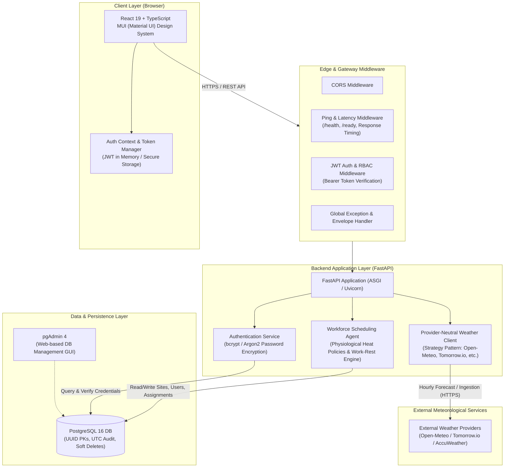
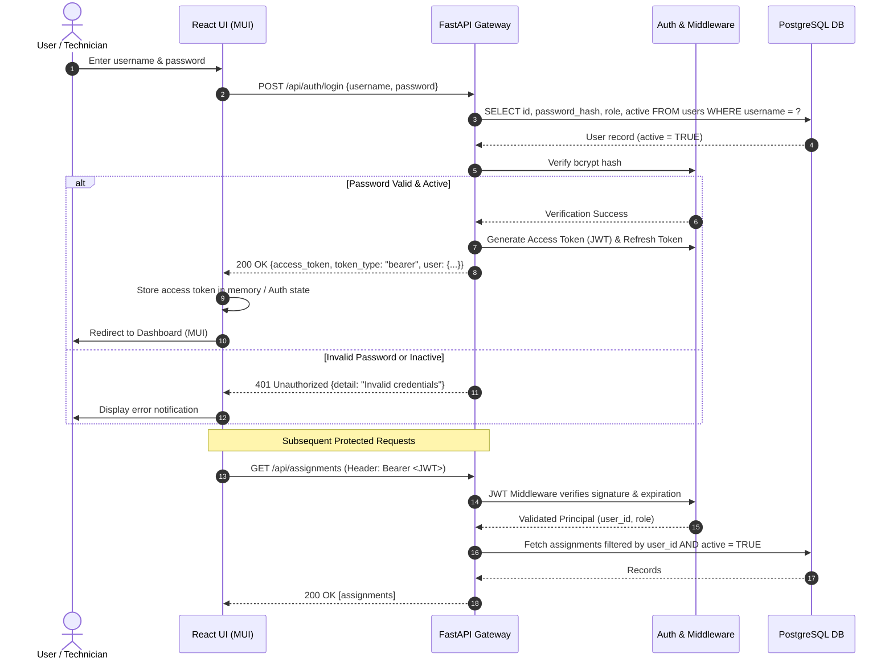
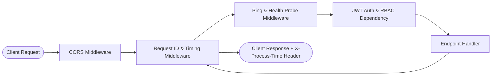
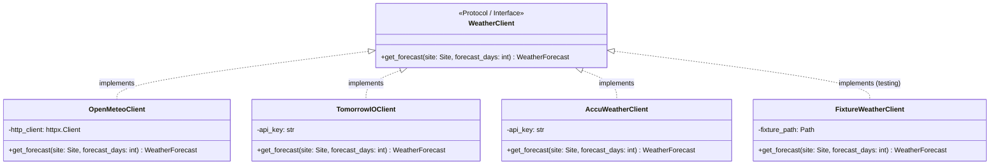
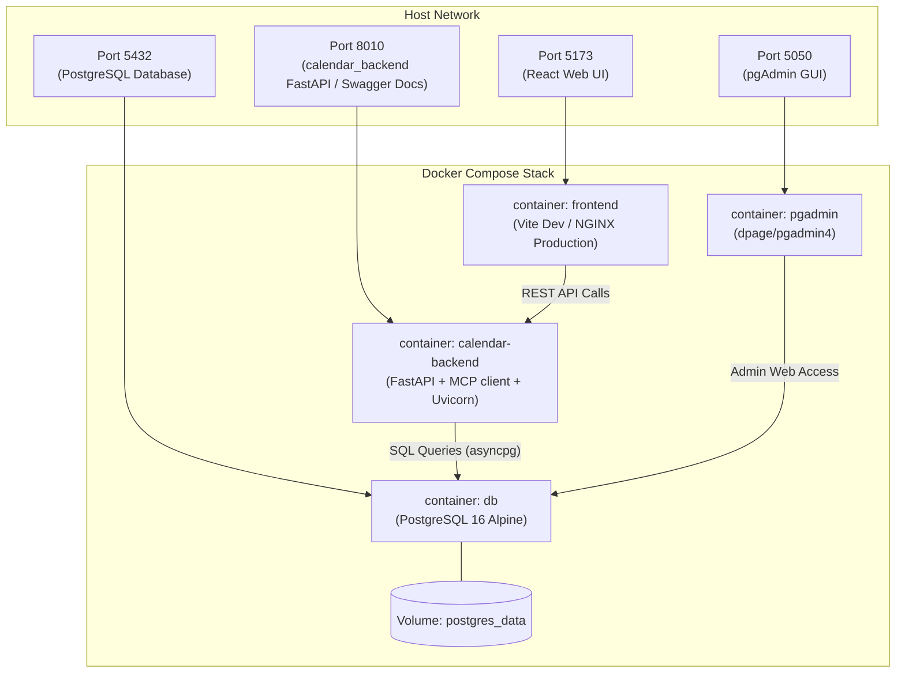

# Technical Architecture Document

This document describes the end-to-end system and technical architecture for the **Climate-Resilient Workforce Agent** platform.

---

## 1. High-Level System Architecture

The platform follows a modern, decoupled, service-oriented architecture comprising a Single Page Application (SPA) frontend, an asynchronous Python API gateway, a relational PostgreSQL persistence layer with pgAdmin, and a provider-neutral meteorological ingestion engine.



---

## 2. Technology Stack Breakdown

| Layer | Technology | Key Libraries / Frameworks | Purpose & Responsibilities |
| :--- | :--- | :--- | :--- |
| **Frontend UI** | React 19, TypeScript, Vite | Material UI (`@mui/material`), `@mui/icons-material`, Emotion | Rich dashboard, role-based interfaces, weather alerts, scheduling calendars. |
| **API Server** | Python 3.11+, FastAPI | Uvicorn, Pydantic v2, Starlette | High-performance asynchronous REST endpoints, validation, middleware, OpenAPI generation. |
| **Security & Auth** | PyJWT, Passlib, bcrypt | `cryptography`, `python-jose` / `pyjwt` | Salted password encryption (bcrypt), stateless JWT token minting, verification, and RBAC enforcement. |
| **Database** | PostgreSQL 16 | `asyncpg` / `psycopg3`, SQLAlchemy 2.0 / SQLModel | Relational ACID store with UUID keys, UTC timestamps, JSONB support, and soft deletes (`active`). |
| **DB Administration** | pgAdmin 4 | Dockerized pgAdmin web container | Visual database introspection, query profiling, index maintenance, and backup administration. |
| **Weather Engine** | Python HTTPX, Pydantic | `httpx>=0.27`, `pydantic-settings` | Resilient, provider-neutral ingestion of wet-bulb temperature, heat index, and storm risk data. |

---

## 3. Security Architecture: Password Encryption & JWT Authentication

### 3.1. Password Encryption
- **Standard**: Passwords must **never** be stored in plaintext.
- **Algorithm**: `bcrypt` (or `Argon2id`) with adaptive work factors (cost factor 12).
- **Hashing Flow**:
  1. User registers or updates password: `hash = bcrypt.hashpw(password.encode('utf-8'), bcrypt.gensalt(rounds=12))`.
  2. Stored in `users.password_hash` column (`VARCHAR(255)`).
  3. Authentication verification uses constant-time comparison to prevent timing attacks.

### 3.2. JWT Token Architecture
The system utilizes dual-token authentication (Access Token + Refresh Token):

```text
┌────────────────────────────────────────────────────────┐
│               JWT Access Token Payload                 │
├────────────────────────────────────────────────────────┤
│  {                                                     │
│    "sub": "b0000000-0000-0000-0000-000000000002",      │  <-- User UUID
│    "username": "rahul.solanki",                        │
│    "role": "technician",                               │  <-- RBAC Role
│    "location_id": "vadodara-gujarat",                  │
│    "exp": 1728950400,                                  │  <-- Short-lived (15-60 mins)
│    "iat": 1728946800,                                  │
│    "type": "access"                                    │
│  }                                                     │
└────────────────────────────────────────────────────────┘
```

- **Access Token**: Short-lived (15–60 minutes), transmitted via the HTTP `Authorization: Bearer <token>` header.
- **Refresh Token**: Long-lived (7–30 days), stored securely (HTTP-only, Secure, SameSite cookie) or securely in database, used exclusively to request fresh access tokens.

### 3.3. Authentication Sequence Diagram



---

## 4. Middleware & Request Lifecycle

FastAPI's ASGI architecture uses modular middleware executed in a strict pipeline:



### 4.1. Ping, Health & Latency Middleware
- **Endpoints**:
  - `GET /health`: Liveness probe verifying the API process is alive.
  - `GET /ready`: Readiness probe verifying PostgreSQL connection pool and external dependencies.
- **Header Injection**: Appends `X-Process-Time-Ms` to all HTTP response headers for real-time latency monitoring in the frontend status pill.

### 4.2. JWT Verification & Dependency Injection
- FastAPI `Depends(get_current_active_user)` extracts and verifies the bearer token.
- Automatically rejects expired tokens with `401 Unauthorized` and logs unauthorized attempts.
- Enforces Role-Based Access Control (RBAC):
  - `technician`: View own assigned work orders, cooling breaks, and weather status.
  - `supervisor`: Create/modify assignments, schedule shifts, view team tree.
  - `safety_officer`: Configure wet-bulb thresholds, trigger site-wide emergency halts.
  - `admin`: User provisioning, location catalogs, site configuration.

### 4.3. CORS Middleware
- Configured with strict origin whitelisting:
  - Local dev: `http://localhost:5173` (Vite)
  - Staging/Production: Custom domain origins.
- Allows methods (`GET`, `POST`, `PUT`, `PATCH`, `DELETE`, `OPTIONS`) and headers (`Authorization`, `Content-Type`).

---

## 5. Provider-Neutral Live Weather Architecture

The weather service uses a **Strategy / Adapter Pattern**. The scheduling engine does not depend on a specific external weather API:



### Key Principles:
1. **Normalized Canonical Model**: All external providers map to the internal `WeatherForecast` Pydantic model (`temperature_c`, `wet_bulb_temperature_c`, `heat_index_c`, `wind_speed_kmh`, `precipitation_mm`, `direct_normal_irradiance_wm2`).
2. **Missing Weather Rule**: Missing intervals are preserved as `null` and **never** treated as safe conditions (strict data integrity).
3. **Staleness Monitoring**: Forecasts older than configured freshness windows flag `is_stale = true` and trigger warning alerts.

---

## 6. Frontend Architecture: React with Material UI (MUI)

The frontend is constructed using **MUI (Material UI v5/v6)** to provide an enterprise-grade, accessible UI:

```text
frontend/src/
├── components/
│   ├── auth/              # ProtectedRoute, LoginForm, RoleGuard
│   ├── layout/            # AppHeader, SidebarNavigation, PageContainer
│   ├── scheduling/        # CalendarView, WorkOrderTable, ShiftTimeline
│   ├── weather/           # HeatStressGauge, WeatherForecastCard, WindAlertBanner
│   └── common/            # StatusChip, ConfirmDialog, MetricSummaryCard
├── theme/
│   ├── palette.ts         # Dark obsidian palette, climate green & alert accents
│   ├── typography.ts      # Google Fonts (Plus Jakarta Sans / Roboto)
│   └── components.ts      # MUI component style overrides (Glassmorphism, buttons)
├── context/
│   ├── AuthContext.tsx    # User session, JWT token state, login/logout actions
│   └── ApiContext.tsx     # Connection status, ping latency, backend status
├── services/
│   ├── apiClient.ts       # Axios / Fetch client with JWT interceptor & auto-refresh
│   ├── authService.ts     # Login, refresh token, profile endpoints
│   ├── siteService.ts     # Site and location endpoints
│   └── weatherService.ts  # Weather ingestion triggers & forecast endpoints
└── pages/
    ├── LoginPage.tsx      # Secure authentication page
    ├── DashboardPage.tsx  # Executive KPIs, site spotlights, live weather alerts
    ├── SitesPage.tsx      # Facility profiles and operating hours
    └── SchedulingPage.tsx # AI proposal review and technician assignment matrix
```

---

## 7. Containerized Deployment Topology (Docker Compose)

The multi-container stack can be orchestrated locally and in production via Docker Compose:



### Sample `docker-compose.yml` Configuration:

```yaml
version: '3.8'

services:
  db:
    image: postgres:16-alpine
    container_name: workforce_postgres
    restart: unless-stopped
    environment:
      POSTGRES_USER: ${POSTGRES_USER:-workforce_user}
      POSTGRES_PASSWORD: ${POSTGRES_PASSWORD:-workforce_secret}
      POSTGRES_DB: ${POSTGRES_DB:-workforce_db}
    ports:
      - "5432:5432"
    volumes:
      - postgres_data:/var/lib/postgresql/data
    healthcheck:
      test: ["CMD-SHELL", "pg_isready -U workforce_user -d workforce_db"]
      interval: 10s
      timeout: 5s
      retries: 5

  pgadmin:
    image: dpage/pgadmin4:latest
    container_name: workforce_pgadmin
    restart: unless-stopped
    environment:
      PGADMIN_DEFAULT_EMAIL: ${PGADMIN_EMAIL:-admin@workforce.local}
      PGADMIN_DEFAULT_PASSWORD: ${PGADMIN_PASSWORD:-admin_secret}
    ports:
      - "5050:80"
    depends_on:
      db:
        condition: service_healthy

  api:
    build:
      context: .
      dockerfile: Dockerfile.api
    container_name: calendar-backend
    restart: unless-stopped
    environment:
      DATABASE_URL: postgresql+asyncpg://workforce_user:workforce_secret@db:5432/workforce_db
      JWT_SECRET_KEY: ${JWT_SECRET_KEY:-your_super_secret_jwt_key_here}
      JWT_ALGORITHM: HS256
      ACCESS_TOKEN_EXPIRE_MINUTES: 60
    ports:
      - "8010:8010"
    depends_on:
      db:
        condition: service_healthy

  frontend:
    build:
      context: ./frontend
      dockerfile: Dockerfile
    container_name: workforce_frontend
    restart: unless-stopped
    environment:
      VITE_API_BASE_URL: http://localhost:8010
    ports:
      - "5173:5173"
    depends_on:
      - api

volumes:
  postgres_data:
```

---

## 8. Summary of Architectural Advantages

1. **Safety Compliance First**: The data layer enforces soft delete (`active`) and UTC timestamps, preventing accidental loss of OSHA/ISO occupational heat exposure records.
2. **Provider Agnostic**: External weather providers can be swapped or aggregated without changing business logic or schema models.
3. **Enterprise Security**: Industry-standard bcrypt password hashing, stateless JWT tokens, and fine-grained RBAC protect operations data.
4. **Resilient Observability**: Built-in ping/latency middleware and `/health` endpoints provide real-time connection visibility in both the backend and frontend status pills.
