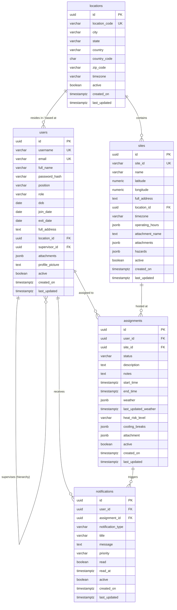

# Database Schema Documentation

This document specifies the relational database schema for the **Climate-Resilient Workforce Agent** platform.

All tables follow standard PostgreSQL/ANSI SQL best practices:
- **Primary Keys**: Decentralized `UUID` identifiers generated with `gen_random_uuid()` (PostgreSQL 13+ default).
- **Soft Deletion**: Every table contains an `active` boolean column (`NOT NULL DEFAULT TRUE`) allowing non-destructive archiving and soft deletion.
- **Audit Columns**: Every table includes `created_on` and `last_updated`, both stored in `TIMESTAMP WITH TIME ZONE` (UTC) with default values set to `(NOW() AT TIME ZONE 'UTC')`.
- **Integrity Constraints**: Explicit foreign keys, check constraints, unique indexes, and sensible cascade rules.

---

## 1. Entity-Relationship Overview (ERD)



---

## 2. Global Column Standards

Every table implements the following standard identification, soft delete, and timestamp columns:

| Column Name | Data Type | Nullable | Default | Description |
| :--- | :--- | :--- | :--- | :--- |
| `id` | `UUID` | **No** | `gen_random_uuid()` | Unique immutable surrogate primary key. |
| `active` | `BOOLEAN` | **No** | `TRUE` | **Soft Delete Flag**: `TRUE` = active record; `FALSE` = soft-deleted/archived. |
| `created_on` | `TIMESTAMPTZ` | **No** | `(NOW() AT TIME ZONE 'UTC')` | Creation timestamp recorded in UTC. |
| `last_updated` | `TIMESTAMPTZ` | **No** | `(NOW() AT TIME ZONE 'UTC')` | Last modification timestamp in UTC, kept current via database trigger. |

---

## 3. Table Specifications

### 3.1. `locations`

Represents regional geographies (e.g., `vadodara-gujarat`) containing one or more industrial sites and service workers.

#### Column Definitions

| Column | Type | Nullable | Default | Description |
| :--- | :--- | :--- | :--- | :--- |
| `id` | `UUID` | **No** | `gen_random_uuid()` | Primary Key. |
| `location_code` *(Suggested)* | `VARCHAR(50)` | **No** | — | Unique slug matching system catalogs (e.g. `vadodara-gujarat`). |
| `display_name` *(Suggested)* | `VARCHAR(150)` | **No** | — | Human-readable name (e.g. `Vadodara, Gujarat`). |
| `city` | `VARCHAR(100)` | **No** | — | City name (e.g. `Vadodara`). |
| `state` | `VARCHAR(100)` | **No** | — | State / Province / Territory (e.g. `Gujarat`). |
| `country` | `VARCHAR(100)` | **No** | — | Full country name (e.g. `India`). |
| `country_code` *(Suggested)* | `CHAR(2)` | **No** | — | ISO 3166-1 alpha-2 code (e.g. `IN`, `US`). |
| `zip_code` | `VARCHAR(20)` | **No** | — | Postal/ZIP code (e.g. `390001`). |
| `latitude` *(Suggested)* | `NUMERIC(9,6)` | Yes | `NULL` | Approximate regional center latitude (`-90` to `90`). |
| `longitude` *(Suggested)* | `NUMERIC(9,6)` | Yes | `NULL` | Approximate regional center longitude (`-180` to `180`). |
| `timezone` *(Suggested)* | `VARCHAR(50)` | **No** | `'UTC'` | Default IANA timezone (e.g. `Asia/Kolkata`). |
| `active` | `BOOLEAN` | **No** | `TRUE` | **Soft Delete Flag**: `TRUE` = active region; `FALSE` = archived. |
| `created_on` | `TIMESTAMPTZ` | **No** | `(NOW() AT TIME ZONE 'UTC')` | UTC record creation timestamp. |
| `last_updated` | `TIMESTAMPTZ` | **No** | `(NOW() AT TIME ZONE 'UTC')` | UTC record update timestamp. |

#### Constraints & Indexes
- `CONSTRAINT pk_locations PRIMARY KEY (id)`
- `CONSTRAINT uq_locations_code UNIQUE (location_code)`
- `CREATE INDEX idx_locations_country_state ON locations(country_code, state);`
- `CREATE INDEX idx_locations_active ON locations(active);`

---

### 3.2. `users`

Stores workforce members, technicians, safety supervisors, and administrators. Supports hierarchical reporting structures (multi-level org tree).

#### Column Definitions

| Column | Type | Nullable | Default | Description |
| :--- | :--- | :--- | :--- | :--- |
| `id` | `UUID` | **No** | `gen_random_uuid()` | Primary Key. |
| `full_name` | `VARCHAR(150)` | **No** | — | Technician / worker full legal name. |
| `username` | `VARCHAR(50)` | **No** | — | Unique authentication username. |
| `password_hash` *(Security)* | `VARCHAR(255)` | **No** | — | Secure salted hash (Argon2id or bcrypt). Plaintext passwords must never be stored. |
| `email` | `VARCHAR(255)` | **No** | — | Unique corporate email address. |
| `phone_number` *(Suggested)* | `VARCHAR(30)` | Yes | `NULL` | Contact phone / mobile number for SMS/emergency alerts. |
| `position` | `VARCHAR(100)` | **No** | — | Job title (e.g. `Electrical Maintenance Technician II`, `Plant Safety Manager`). |
| `role` *(Suggested)* | `VARCHAR(30)` | **No** | `'technician'` | System access role (`technician`, `supervisor`, `safety_officer`, `admin`). |
| `dob` | `DATE` | **No** | — | Date of birth (used for employee identity, benefits, and labor law age validation). |
| `join_date` | `DATE` | **No** | `CURRENT_DATE` | Date employee joined the organization. |
| `exit_date` | `DATE` | Yes | `NULL` | Date of departure; `NULL` for active employees. |
| `full_address` | `TEXT` | **No** | — | Full residential/dispatch address. |
| `location_id` | `UUID` | **No** | — | Foreign Key &rarr; `locations(id)`. Primary assigned geographical region. |
| `supervisor_id` | `UUID` | Yes | `NULL` | Self-referencing Foreign Key &rarr; `users(id)`. Top-level managers have `NULL`. |
| `attachments` | `JSONB` | **No** | `'[]'::jsonb` | Array of attachment metadata (e.g., contracts, medical clearance, onboarding docs). |
| `profile_picture` | `TEXT` | Yes | `NULL` | URL or cloud storage path (S3/GCS bucket key). |
| `skills` *(Suggested)* | `TEXT[]` | **No** | `'{}'` | Technical capabilities (e.g., `['high_voltage', 'confined_space', 'welding']`). |
| `certifications` *(Suggested)* | `JSONB` | **No** | `'[]'::jsonb` | Active credentials with expiration dates (mirrors `workforce_agent.schemas.Certification`). |
| `max_shift_minutes` *(Suggested)* | `INTEGER` | **No** | `480` | Maximum continuous allowable shift length in minutes (default 8h = 480m). |
| `active` | `BOOLEAN` | **No** | `TRUE` | **Soft Delete Flag**: `TRUE` = active employee; `FALSE` = deleted/deactivated. |
| `created_on` | `TIMESTAMPTZ` | **No** | `(NOW() AT TIME ZONE 'UTC')` | UTC record creation timestamp. |
| `last_updated` | `TIMESTAMPTZ` | **No** | `(NOW() AT TIME ZONE 'UTC')` | UTC record update timestamp. |

#### Hierarchy & Supervision
- `supervisor_id` implements an **Adjacency List** pattern.
- This allows recursive queries (using PostgreSQL Recursive CTEs) to query:
  - All direct and indirect subordinates under any supervisor.
  - The entire reporting chain from any technician up to the CEO/Department Head.

#### Constraints & Indexes
- `CONSTRAINT pk_users PRIMARY KEY (id)`
- `CONSTRAINT uq_users_username UNIQUE (username)`
- `CONSTRAINT uq_users_email UNIQUE (email)`
- `CONSTRAINT fk_users_location FOREIGN KEY (location_id) REFERENCES locations(id) ON DELETE RESTRICT`
- `CONSTRAINT fk_users_supervisor FOREIGN KEY (supervisor_id) REFERENCES users(id) ON DELETE SET NULL`
- `CONSTRAINT chk_users_dates CHECK (dob <= CURRENT_DATE AND (exit_date IS NULL OR exit_date >= join_date) AND join_date > dob)`
- `CREATE INDEX idx_users_location_id ON users(location_id);`
- `CREATE INDEX idx_users_supervisor_id ON users(supervisor_id);`
- `CREATE INDEX idx_users_role_active ON users(role, active);`
- `CREATE INDEX idx_users_active ON users(active);`

---

### 3.3. `sites`

Represents physical industrial infrastructure (e.g. process plants, substations, pipelines) where maintenance assignments take place.

#### Column Definitions

| Column | Type | Nullable | Default | Description |
| :--- | :--- | :--- | :--- | :--- |
| `id` | `UUID` | **No** | `gen_random_uuid()` | Primary Key. |
| `site_id` | `VARCHAR(50)` | **No** | — | Unique business code (e.g. `VAD-PLANT-01`, `VAD-SUB-02`). |
| `name` | `VARCHAR(150)` | **No** | — | Facility display name (e.g. `Vadodara Process Plant`). |
| `description` | `TEXT` | Yes | `NULL` | Facility background, boundary info, and equipment scope. |
| `latitude` | `NUMERIC(9,6)` | **No** | — | Precise GPS latitude (`-90.0` to `90.0`). Used for Open-Meteo weather fetch. |
| `longitude` | `NUMERIC(9,6)` | **No** | — | Precise GPS longitude (`-180.0` to `180.0`). Used for Open-Meteo weather fetch. |
| `full_address` | `TEXT` | **No** | — | Street address or road corridor description. |
| `location_id` | `UUID` | **No** | — | Foreign Key &rarr; `locations(id)`. Parent location catalog. |
| `attachment_name` | `TEXT` | Yes | `NULL` | Primary site blueprint / emergency evacuation plan document name. |
| `attachments` *(Suggested)* | `JSONB` | **No** | `'[]'::jsonb` | Multiple site files (safety sheets, entry permits, layout diagrams). |
| `timezone` *(Suggested)* | `VARCHAR(50)` | **No** | `'Asia/Kolkata'` | Facility IANA timezone. Required to resolve local shift hours accurately. |
| `operating_hours` *(Suggested)* | `JSONB` | **No** | `'[]'::jsonb` | Weekly operating hours array (weekday `0`..`6`, `start_local`, `end_local`). |
| `hazards` *(Suggested)* | `JSONB` | **No** | `'[]'::jsonb` | Monitored hazard types (e.g. `["extreme_heat", "monsoon", "chemical", "height"]`). |
| `active` | `BOOLEAN` | **No** | `TRUE` | **Soft Delete Flag**: `TRUE` = operational site; `FALSE` = decommissioned/archived. |
| `created_on` | `TIMESTAMPTZ` | **No** | `(NOW() AT TIME ZONE 'UTC')` | UTC record creation timestamp. |
| `last_updated` | `TIMESTAMPTZ` | **No** | `(NOW() AT TIME ZONE 'UTC')` | UTC record update timestamp. |

#### Constraints & Indexes
- `CONSTRAINT pk_sites PRIMARY KEY (id)`
- `CONSTRAINT uq_sites_site_id UNIQUE (site_id)`
- `CONSTRAINT fk_sites_location FOREIGN KEY (location_id) REFERENCES locations(id) ON DELETE RESTRICT`
- `CONSTRAINT chk_sites_latitude CHECK (latitude BETWEEN -90.0 AND 90.0)`
- `CONSTRAINT chk_sites_longitude CHECK (longitude BETWEEN -180.0 AND 180.0)`
- `CREATE INDEX idx_sites_location_id ON sites(location_id);`
- `CREATE INDEX idx_sites_coords ON sites(latitude, longitude);`
- `CREATE INDEX idx_sites_active ON sites(active);`

---

### 3.4. `assignments`

Connects workers to sites for specific work orders. Incorporates weather intelligence snapshots, wet-bulb stress thresholds, and mandatory cooling breaks.

#### Column Definitions

| Column | Type | Nullable | Default | Description |
| :--- | :--- | :--- | :--- | :--- |
| `id` | `UUID` | **No** | `gen_random_uuid()` | Primary Key. |
| `user_id` | `UUID` | **No** | — | Foreign Key &rarr; `users(id)`. Assigned technician. |
| `site_id` | `UUID` | **No** | — | Foreign Key &rarr; `sites(id)`. Target facility. |
| `status` | `VARCHAR(30)` | **No** | `'scheduled'` | Current lifecycle status (`draft`, `scheduled`, `in_progress`, `completed`, `cancelled`, `delayed_weather`, `heat_stop`). |
| `description` | `TEXT` | **No** | — | Maintenance task scope and objectives. |
| `notes` | `TEXT` | Yes | `NULL` | Shift notes, supervisor instructions, or field handoff comments. |
| `start_time` | `TIMESTAMPTZ` | **No** | — | Scheduled work start time in UTC. |
| `end_time` | `TIMESTAMPTZ` | **No** | — | Scheduled work end time in UTC. |
| `weather` | `JSONB` | Yes | `NULL` | Snapshot of environmental forecast at scheduled interval (temp, wet bulb, heat index, wind, irradiance). |
| `last_updated_weather`| `TIMESTAMPTZ` | Yes | `NULL` | Timestamp in UTC when weather snapshot was last evaluated from Open-Meteo. |
| `attachment` | `JSONB` | Yes | `NULL` | Work permits, lock-out/tag-out (LOTO) forms, or sign-off documentation. |
| `heat_risk_level` *(Suggested)* | `VARCHAR(20)` | Yes | `NULL` | Evaluated risk tier (`low`, `moderate`, `high`, `extreme`). |
| `cooling_breaks` *(Suggested)* | `JSONB` | **No** | `'[]'::jsonb` | Prescribed physiological cooling break intervals (e.g. `[{"start": "...", "duration_minutes": 15, "reason": "WBGT > 30C"}]`). |
| `work_order_id` *(Suggested)* | `VARCHAR(50)` | Yes | `NULL` | Business work order identifier (e.g. `WO-2026-0812`). |
| `assigned_by` *(Suggested)* | `UUID` | Yes | `NULL` | Foreign Key &rarr; `users(id)`. Dispatcher / supervisor who authored the schedule. |
| `active` | `BOOLEAN` | **No** | `TRUE` | **Soft Delete Flag**: `TRUE` = active assignment; `FALSE` = deleted/archived. |
| `created_on` | `TIMESTAMPTZ` | **No** | `(NOW() AT TIME ZONE 'UTC')` | UTC record creation timestamp. |
| `last_updated` | `TIMESTAMPTZ` | **No** | `(NOW() AT TIME ZONE 'UTC')` | UTC record update timestamp. |

#### Constraints & Indexes
- `CONSTRAINT pk_assignments PRIMARY KEY (id)`
- `CONSTRAINT fk_assignments_user FOREIGN KEY (user_id) REFERENCES users(id) ON DELETE RESTRICT`
- `CONSTRAINT fk_assignments_site FOREIGN KEY (site_id) REFERENCES sites(id) ON DELETE RESTRICT`
- `CONSTRAINT fk_assignments_assigned_by FOREIGN KEY (assigned_by) REFERENCES users(id) ON DELETE SET NULL`
- `CONSTRAINT chk_assignments_times CHECK (end_time > start_time)`
- `CONSTRAINT chk_assignments_status CHECK (status IN ('draft', 'scheduled', 'in_progress', 'completed', 'cancelled', 'delayed_weather', 'heat_stop'))`
- `CREATE INDEX idx_assignments_user_time ON assignments(user_id, start_time, end_time);`
- `CREATE INDEX idx_assignments_site_time ON assignments(site_id, start_time, end_time);`
- `CREATE INDEX idx_assignments_status ON assignments(status);`
- `CREATE INDEX idx_assignments_active ON assignments(active);`

---

### 3.5. `notifications`

Alerts workers and supervisors regarding weather threshold violations, cooling break requirements, assignment changes, and safety halts.

#### Column Definitions

| Column | Type | Nullable | Default | Description |
| :--- | :--- | :--- | :--- | :--- |
| `id` | `UUID` | **No** | `gen_random_uuid()` | Primary Key. |
| `user_id` *(Crucial Suggestion)* | `UUID` | **No** | — | Foreign Key &rarr; `users(id)`. Target recipient of the notification. |
| `assignment_id` | `UUID` | Yes | `NULL` | Foreign Key &rarr; `assignments(id)`. Related assignment (or `NULL` for system-wide notices). |
| `read` | `BOOLEAN` | **No** | `FALSE` | Read / unread status flag. |
| `title` *(Suggested)* | `VARCHAR(150)` | **No** | — | Short alert headline (e.g. `Extreme Heat Advisory: 30-min break required`). |
| `message` *(Suggested)* | `TEXT` | **No** | — | Full details, recommended action, and emergency contact instructions. |
| `notification_type` *(Suggested)* | `VARCHAR(50)` | **No** | `'general'` | Category (`heat_alert`, `storm_halt`, `assignment_update`, `cooling_break`, `system`). |
| `priority` *(Suggested)* | `VARCHAR(20)` | **No** | `'medium'` | Severity level (`low`, `medium`, `high`, `critical`). |
| `read_at` *(Suggested)* | `TIMESTAMPTZ` | Yes | `NULL` | Timestamp in UTC when user marked/opened the notification. |
| `active` | `BOOLEAN` | **No** | `TRUE` | **Soft Delete Flag**: `TRUE` = active notification; `FALSE` = dismissed/soft-deleted. |
| `created_on` | `TIMESTAMPTZ` | **No** | `(NOW() AT TIME ZONE 'UTC')` | UTC record creation timestamp. |
| `last_updated` | `TIMESTAMPTZ` | **No** | `(NOW() AT TIME ZONE 'UTC')` | UTC record update timestamp. |

#### Constraints & Indexes
- `CONSTRAINT pk_notifications PRIMARY KEY (id)`
- `CONSTRAINT fk_notifications_user FOREIGN KEY (user_id) REFERENCES users(id) ON DELETE CASCADE`
- `CONSTRAINT fk_notifications_assignment FOREIGN KEY (assignment_id) REFERENCES assignments(id) ON DELETE CASCADE`
- `CREATE INDEX idx_notifications_user_unread ON notifications(user_id, read) WHERE read = FALSE AND active = TRUE;`
- `CREATE INDEX idx_notifications_assignment ON notifications(assignment_id);`
- `CREATE INDEX idx_notifications_active ON notifications(active);`

---

## 4. Key Architectural Suggestions & Rationale

1. **`active` Column on Every Table (Soft Delete)**:
   - *Rationale*: Field service, occupational safety, and maintenance assignments are legally auditable records. Hard deletion (`DELETE FROM ...`) can cause permanent loss of safety compliance data or break foreign key references. Soft deletion (`UPDATE ... SET active = FALSE`) preserves complete historical data while allowing applications to filter active records (`WHERE active = TRUE`).
2. **`user_id` in `notifications` Table**:
   - *Rationale*: A notification table without a recipient `user_id` cannot support per-worker inboxes, badge counts, or selective push notifications.
3. **`password_hash` instead of plaintext `password`**:
   - *Rationale*: Storing plaintext passwords violates cybersecurity compliance standards (SOC 2, ISO 27001). We use `password_hash` (compatible with bcrypt or Argon2).
4. **`timezone` in `sites` & `locations`**:
   - *Rationale*: All timestamps are stored in UTC (`TIMESTAMPTZ`). However, sites have local working hours (e.g., 06:00 to 18:00 IST in `src/workforce_agent/locations/vadodara.json`). Storing the IANA timezone identifier enables precise local scheduling and weather correlation.
5. **`JSONB` for `weather`, `cooling_breaks`, and `attachments`**:
   - *Rationale*: Allows storing rich, provider-neutral hourly weather payloads and file metadata without necessitating overly rigid secondary tables, while still supporting PostgreSQL GIN indexing for fast querying.
6. **Supervisor Self-Referencing Foreign Key (`supervisor_id`)**:
   - *Rationale*: Enables multi-level reporting (technician &rarr; lead technician &rarr; maintenance manager &rarr; plant director). Hierarchies are easily traversed using recursive CTE queries without recursion depth limits.

---

## 5. Ready-to-Run PostgreSQL DDL Script

Below is the complete SQL script to create all tables, triggers, and indexes in PostgreSQL:

```sql
-- 1. Enable UUID Extension
CREATE EXTENSION IF NOT EXISTS "pgcrypto";

-- 2. Generic Trigger Function for UTC last_updated
CREATE OR REPLACE FUNCTION trigger_set_last_updated()
RETURNS TRIGGER AS $$
BEGIN
    NEW.last_updated = (NOW() AT TIME ZONE 'UTC');
    RETURN NEW;
END;
$$ LANGUAGE plpgsql;

-- 3. LOCATIONS TABLE
CREATE TABLE locations (
    id UUID PRIMARY KEY DEFAULT gen_random_uuid(),
    location_code VARCHAR(50) NOT NULL UNIQUE,
    display_name VARCHAR(150) NOT NULL,
    city VARCHAR(100) NOT NULL,
    state VARCHAR(100) NOT NULL,
    country VARCHAR(100) NOT NULL,
    country_code CHAR(2) NOT NULL,
    zip_code VARCHAR(20) NOT NULL,
    latitude NUMERIC(9,6) CHECK (latitude BETWEEN -90.0 AND 90.0),
    longitude NUMERIC(9,6) CHECK (longitude BETWEEN -180.0 AND 180.0),
    timezone VARCHAR(50) NOT NULL DEFAULT 'UTC',
    active BOOLEAN NOT NULL DEFAULT TRUE,
    created_on TIMESTAMPTZ NOT NULL DEFAULT (NOW() AT TIME ZONE 'UTC'),
    last_updated TIMESTAMPTZ NOT NULL DEFAULT (NOW() AT TIME ZONE 'UTC')
);

CREATE INDEX idx_locations_country_state ON locations(country_code, state);
CREATE INDEX idx_locations_active ON locations(active);

CREATE TRIGGER trg_locations_last_updated
BEFORE UPDATE ON locations
FOR EACH ROW EXECUTE FUNCTION trigger_set_last_updated();

-- 4. USERS TABLE
CREATE TABLE users (
    id UUID PRIMARY KEY DEFAULT gen_random_uuid(),
    full_name VARCHAR(150) NOT NULL,
    username VARCHAR(50) NOT NULL UNIQUE,
    password_hash VARCHAR(255) NOT NULL,
    email VARCHAR(255) NOT NULL UNIQUE,
    phone_number VARCHAR(30),
    position VARCHAR(100) NOT NULL,
    role VARCHAR(30) NOT NULL DEFAULT 'technician',
    dob DATE NOT NULL,
    join_date DATE NOT NULL DEFAULT CURRENT_DATE,
    exit_date DATE,
    full_address TEXT NOT NULL,
    location_id UUID NOT NULL REFERENCES locations(id) ON DELETE RESTRICT,
    supervisor_id UUID REFERENCES users(id) ON DELETE SET NULL,
    attachments JSONB NOT NULL DEFAULT '[]'::jsonb,
    profile_picture TEXT,
    skills TEXT[] NOT NULL DEFAULT '{}',
    certifications JSONB NOT NULL DEFAULT '[]'::jsonb,
    max_shift_minutes INTEGER NOT NULL DEFAULT 480,
    active BOOLEAN NOT NULL DEFAULT TRUE,
    created_on TIMESTAMPTZ NOT NULL DEFAULT (NOW() AT TIME ZONE 'UTC'),
    last_updated TIMESTAMPTZ NOT NULL DEFAULT (NOW() AT TIME ZONE 'UTC'),
    CONSTRAINT chk_users_dates CHECK (
        dob <= CURRENT_DATE
        AND (exit_date IS NULL OR exit_date >= join_date)
        AND join_date > dob
    )
);

CREATE INDEX idx_users_location_id ON users(location_id);
CREATE INDEX idx_users_supervisor_id ON users(supervisor_id);
CREATE INDEX idx_users_role_active ON users(role, active);
CREATE INDEX idx_users_active ON users(active);

CREATE TRIGGER trg_users_last_updated
BEFORE UPDATE ON users
FOR EACH ROW EXECUTE FUNCTION trigger_set_last_updated();

-- 5. SITES TABLE
CREATE TABLE sites (
    id UUID PRIMARY KEY DEFAULT gen_random_uuid(),
    site_id VARCHAR(50) NOT NULL UNIQUE,
    name VARCHAR(150) NOT NULL,
    description TEXT,
    latitude NUMERIC(9,6) NOT NULL CHECK (latitude BETWEEN -90.0 AND 90.0),
    longitude NUMERIC(9,6) NOT NULL CHECK (longitude BETWEEN -180.0 AND 180.0),
    full_address TEXT NOT NULL,
    location_id UUID NOT NULL REFERENCES locations(id) ON DELETE RESTRICT,
    attachment_name TEXT,
    attachments JSONB NOT NULL DEFAULT '[]'::jsonb,
    timezone VARCHAR(50) NOT NULL DEFAULT 'Asia/Kolkata',
    operating_hours JSONB NOT NULL DEFAULT '[]'::jsonb,
    hazards JSONB NOT NULL DEFAULT '[]'::jsonb,
    active BOOLEAN NOT NULL DEFAULT TRUE,
    created_on TIMESTAMPTZ NOT NULL DEFAULT (NOW() AT TIME ZONE 'UTC'),
    last_updated TIMESTAMPTZ NOT NULL DEFAULT (NOW() AT TIME ZONE 'UTC')
);

CREATE INDEX idx_sites_location_id ON sites(location_id);
CREATE INDEX idx_sites_coords ON sites(latitude, longitude);
CREATE INDEX idx_sites_active ON sites(active);

CREATE TRIGGER trg_sites_last_updated
BEFORE UPDATE ON sites
FOR EACH ROW EXECUTE FUNCTION trigger_set_last_updated();

-- 6. ASSIGNMENTS TABLE
CREATE TABLE assignments (
    id UUID PRIMARY KEY DEFAULT gen_random_uuid(),
    user_id UUID NOT NULL REFERENCES users(id) ON DELETE RESTRICT,
    site_id UUID NOT NULL REFERENCES sites(id) ON DELETE RESTRICT,
    status VARCHAR(30) NOT NULL DEFAULT 'scheduled',
    description TEXT NOT NULL,
    notes TEXT,
    start_time TIMESTAMPTZ NOT NULL,
    end_time TIMESTAMPTZ NOT NULL,
    weather JSONB,
    last_updated_weather TIMESTAMPTZ,
    heat_risk_level VARCHAR(20),
    cooling_breaks JSONB NOT NULL DEFAULT '[]'::jsonb,
    attachment JSONB,
    work_order_id VARCHAR(50),
    assigned_by UUID REFERENCES users(id) ON DELETE SET NULL,
    active BOOLEAN NOT NULL DEFAULT TRUE,
    created_on TIMESTAMPTZ NOT NULL DEFAULT (NOW() AT TIME ZONE 'UTC'),
    last_updated TIMESTAMPTZ NOT NULL DEFAULT (NOW() AT TIME ZONE 'UTC'),
    CONSTRAINT chk_assignments_times CHECK (end_time > start_time),
    CONSTRAINT chk_assignments_status CHECK (
        status IN ('draft', 'scheduled', 'in_progress', 'completed', 'cancelled', 'delayed_weather', 'heat_stop')
    )
);

CREATE INDEX idx_assignments_user_time ON assignments(user_id, start_time, end_time);
CREATE INDEX idx_assignments_site_time ON assignments(site_id, start_time, end_time);
CREATE INDEX idx_assignments_status ON assignments(status);
CREATE INDEX idx_assignments_active ON assignments(active);

CREATE TRIGGER trg_assignments_last_updated
BEFORE UPDATE ON assignments
FOR EACH ROW EXECUTE FUNCTION trigger_set_last_updated();

-- 7. NOTIFICATIONS TABLE
CREATE TABLE notifications (
    id UUID PRIMARY KEY DEFAULT gen_random_uuid(),
    user_id UUID NOT NULL REFERENCES users(id) ON DELETE CASCADE,
    assignment_id UUID REFERENCES assignments(id) ON DELETE CASCADE,
    read BOOLEAN NOT NULL DEFAULT FALSE,
    title VARCHAR(150) NOT NULL,
    message TEXT NOT NULL,
    notification_type VARCHAR(50) NOT NULL DEFAULT 'general',
    priority VARCHAR(20) NOT NULL DEFAULT 'medium',
    read_at TIMESTAMPTZ,
    active BOOLEAN NOT NULL DEFAULT TRUE,
    created_on TIMESTAMPTZ NOT NULL DEFAULT (NOW() AT TIME ZONE 'UTC'),
    last_updated TIMESTAMPTZ NOT NULL DEFAULT (NOW() AT TIME ZONE 'UTC')
);

CREATE INDEX idx_notifications_user_unread ON notifications(user_id, read) WHERE read = FALSE AND active = TRUE;
CREATE INDEX idx_notifications_assignment ON notifications(assignment_id);
CREATE INDEX idx_notifications_active ON notifications(active);

CREATE TRIGGER trg_notifications_last_updated
BEFORE UPDATE ON notifications
FOR EACH ROW EXECUTE FUNCTION trigger_set_last_updated();
```

---

## 6. Query Patterns & Best Practices

### 6.1. Soft Deleting and Querying Active Records

```sql
-- Soft deleting an assignment (non-destructive)
UPDATE assignments
SET active = FALSE
WHERE id = 'c0000000-0000-0000-0000-000000000003';

-- Selecting only active sites in Gujarat
SELECT site_id, name, latitude, longitude, timezone
FROM sites
WHERE active = TRUE
  AND location_id = (SELECT id FROM locations WHERE location_code = 'vadodara-gujarat' AND active = TRUE);

-- Fetching unread notifications for a technician
SELECT id, title, message, priority, created_on
FROM notifications
WHERE user_id = 'b0000000-0000-0000-0000-000000000002'
  AND read = FALSE
  AND active = TRUE
ORDER BY created_on DESC;
```

### 6.2. Traversing the Supervisor Hierarchy (Top to Bottom)

Using a Recursive Common Table Expression (CTE) to find all active subordinates reporting under a specific supervisor:

```sql
WITH RECURSIVE org_hierarchy AS (
    -- Anchor: Find the target supervisor
    SELECT id, full_name, position, supervisor_id, 1 AS depth
    FROM users
    WHERE id = 'a0000000-0000-0000-0000-000000000001'
      AND active = TRUE

    UNION ALL

    -- Recursive Step: Find all direct reports
    SELECT u.id, u.full_name, u.position, u.supervisor_id, oh.depth + 1
    FROM users u
    INNER JOIN org_hierarchy oh ON u.supervisor_id = oh.id
    WHERE u.active = TRUE
)
SELECT * FROM org_hierarchy ORDER BY depth, full_name;
```

### 6.3. Preventing Overlapping Shifts for Technicians

Detecting schedule conflicts before inserting a new assignment:

```sql
SELECT id, site_id, start_time, end_time, status
FROM assignments
WHERE user_id = 'b0000000-0000-0000-0000-000000000002'
  AND active = TRUE
  AND status NOT IN ('cancelled')
  AND tstzrange(start_time, end_time, '[)') && tstzrange('2026-10-15 08:00:00Z', '2026-10-15 16:00:00Z', '[)');
```
