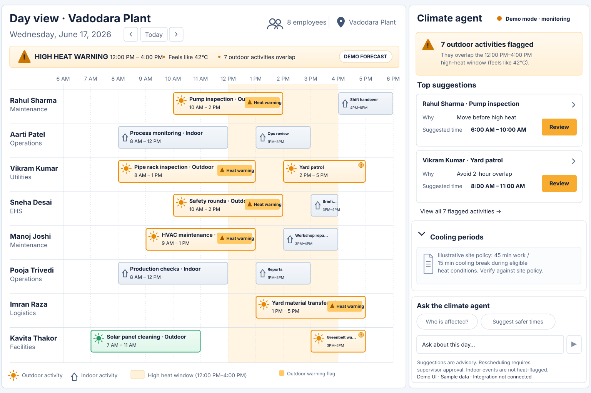

# Product Requirements: Climate-Resilient Workforce Calendar

**Status:** MVP product brief  
**Primary screen:** Single-day employee calendar with climate agent side panel  
**Audience:** Site supervisors, operations managers, and EHS leads  
**Architecture principle:** Reusable climate-agent capabilities exposed through MCP and a service/API contract

## 1. Product vision
Help supervisors see every outdoor activity that overlaps a climate warning, understand why it is affected, and ask an agent to suggest schedule changes. The climate agent should also be consumable by third-party scheduling/calendar tools through an MCP server, or by custom services that use the same structured action suggestions.

This is a decision-support product. Deterministic policy validation—not the LLM—is authoritative for whether a proposed schedule is allowed.

## 2. MVP boundaries
- Build **one screen only**: a Google Calendar-style **day view**, with one timeline row per employee and the climate-agent panel on the right.
- Do not build week/month views, multi-screen analytics, optimization, historical insights, or workforce performance scoring.
- Show the selected site/date, employees, activity times, activity location/type, climate warnings, and suggestions.
- Flag **all outdoor activities whose time intervals overlap a climate warning**, including partial overlaps. Indoor activities are not flagged solely because a warning is active.
- Unknown activity type/location or stale/missing weather is marked needs-review; never silently assume safe.
- The agent can suggest and prepare rescheduling proposals. A supervisor must explicitly approve rescheduling before a calendar event's time changes.
- A configurable background check detects affected events without requiring the UI to be open.
- For affected outdoor events, a configured calendar integration may append an informational climate disclaimer to event notes. This is separate from rescheduling and must be idempotent.
- Expose reusable capabilities through an MCP server and a service/API contract for non-MCP integrations.

## 3. Primary supervisor journey
1. Open the site's selected day and see all employee schedules.
2. Identify every outdoor activity overlapping a climate warning.
3. Read the banner and inspect each flagged activity's reason, warning window, forecast freshness, and policy context.
4. Review the agent's precomputed suggestions or chat with the agent to provide constraints (for example, move inspections before noon).
5. Inspect the proposed schedule changes and any tasks with no feasible safe alternative.
6. Approve, reject, or request revision.
7. After approval, the calendar integration applies only the approved changes and reports the outcome.
8. Independently, the configured background check may append/update the climate disclaimer on affected outdoor event notes; it never changes event time.

## 4. Main screen requirements

### A. Single-day employee calendar
- Only day view is supported in MVP; no week/month toggle.
- Rows represent employees and show name plus operational role/team.
- The time axis uses the site's timezone; activity cards use actual start/end times.
- Activity cards display title, time, location, and indoor/outdoor/unknown classification.
- Outdoor activities overlapping warning intervals show a visible icon, text label, and warning state; do not rely on color alone.
- Show the climate warning interval as a background band and include a legend.
- Every matching outdoor activity is flagged, not just the top suggestions.
- Indoor activities remain unflagged based on weather alone.
- Include loading, empty, error, and responsive states.

### B. Climate warning summary
- Show severity, warning start/end, relevant weather measure, forecast updated-at/source, and computed affected activity count.
- Counts are derived from the schedule and warnings, never hardcoded.
- Stale/incomplete/unavailable weather is explicit and does not imply safe conditions.

### C. Climate-agent panel
- Show affected-event count and useful suggested schedule updates near the top.
- Each suggestion includes activity/employee, current time, proposed time if feasible, rationale, relevant warning/policy, and validation status.
- Supervisor can chat, provide constraints, ask who is affected, and request rescheduling.
- The agent may ask clarification when intent or constraints are insufficient.
- No feasible alternative must be represented explicitly; never invent a time.
- Agent status and MCP connection status must be truthful.

### D. Supervisor approval
- Review current versus proposed times, affected employees/resources, climate and policy rationale, and validation results.
- Support approve, reject, and request revision.
- Revalidate policy, availability, and source calendar event version before applying.
- Pending/rejected proposals never change event times.
- Record actor, decision, timestamp, and integration outcome.

### E. Background monitoring and event notes
- A configurable background job checks upcoming scheduled activities against the latest available forecast and configured policy.
- It flags all outdoor activities overlapping climate warnings; indoor activities receive no weather-only action.
- When enabled and authorized, append a concise disclaimer to affected outdoor event notes with warning window, relevant forecast measure, source/update time, and a reminder to follow site policy.
- Preserve existing notes, use a clearly delimited product-owned section, and make repeated runs idempotent.
- Note annotation must not change event time, attendees, or other unrelated content.
- Failed calendar writes must be reported accurately; a note is informational, not a declaration that work is safe.

## 5. Agent/MCP and integration requirements
- MCP server exposes documented tools with typed input/output schemas.
- Initial tool capabilities: list affected activities, get climate suggestions, create a rescheduling proposal, and invoke the configured event-note annotation flow.
- MCP tools and the UI call the same core application services and deterministic validators.
- Provide a reusable service/API contract so custom-built scheduling systems can consume structured suggestions without implementing an MCP client.
- Separate read, proposal, annotation, and rescheduling permissions/actions.
- Proposal-generation tools must not directly reschedule calendar events.
- Do not claim a provider or MCP connection exists unless health/status confirms it.

## 6. Functional requirements
- FR-01: Return selected-day employee schedules with stable activity IDs, site timezone, location, and indoor/outdoor/unknown classification.
- FR-02: Normalize forecast data and retain freshness/completeness/source metadata.
- FR-03: Deterministically flag every outdoor activity overlapping one or more warning intervals.
- FR-04: Explain each flag with the relevant warning interval and configured policy reason.
- FR-05: Generate structured feasible rescheduling suggestions and explicit no-feasible-slot results.
- FR-06: Accept supervisor constraints through chat and validate them before creating proposals.
- FR-07: Require explicit supervisor approval and revalidation before changing calendar event times.
- FR-08: Run background climate checks independently of the page being open.
- FR-09: Append/update informational notes for affected outdoor events when enabled, without duplicating content.
- FR-10: Expose shared capabilities through MCP and a reusable service/API contract.
- FR-11: Provide deterministic fixtures for repeatable demo and tests.

## 7. Safety, privacy, and reliability
- Deterministic policy validation is authoritative; the LLM cannot override it.
- Unknown/stale weather, unknown location/type, or unknown policy yields unknown/needs-review—not safe.
- No schedule changes without explicit supervisor approval.
- Event-note disclaimers are informational, preserve existing notes, and never replace official safety procedures.
- Do not invent medical thresholds or present demo policy as official workplace guidance.
- Minimize personal data and show only operationally necessary employee information.
- Use site-local timestamps consistently; test timezone and interval boundaries.
- Background jobs and note annotations must be retry-safe and idempotent.

## 8. MVP success criteria
- A reviewer can identify the warning window and affected outdoor activities within 10 seconds.
- Every outdoor activity overlapping a warning is flagged, including partial overlap; indoor tasks are not weather-flagged.
- Every suggestion has an explanation and validation state.
- Unsafe proposals are blocked and pending/rejected proposals cannot change calendar events.
- Repeated background runs do not duplicate disclaimers.
- MCP and service/API clients receive the same structured results as the UI.
- Demo works without live credentials and clearly labels fixture/simulated integrations.

## 9. Delivery sequence
1. Day-view schedule contract and single-day calendar layout.
2. Deterministic warning-overlap detection and banner/flag UI.
3. Shared suggestion service and agent side panel/chat.
4. MCP server and non-MCP service/API contract.
5. Supervisor review and approval-gated rescheduling.
6. Background monitoring and idempotent calendar-note annotation.
7. Deterministic end-to-end demo, safety tests, accessibility, and integration documentation.

## 10. Design reference
Use the corrected design reference below: a wide employee-by-time day calendar on the left and a climate-agent panel on the right. Event cards use the same 6 AM–6 PM time scale as the timeline, the high-heat interval is 12:00 PM–4:00 PM, and every outdoor activity with any overlap is flagged. The count and event data are illustrative fixture values, not a live forecast; the MCP/calendar integration is not connected in the design mockup.

*Design reference only. The illustrated cooling policy and weather values are illustrative and must be confirmed against the configured site policy and forecast before operational use.*
